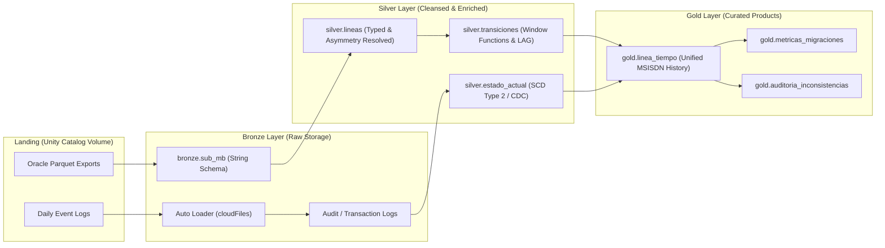

# 📡 Enterprise Telco Subscriber Lifecycle & Governance Lakehouse

<p align="left">
  
  
  
  
  
  
</p>

An end-to-end, enterprise-grade **Medallion Lakehouse architecture** designed to solve complex subscriber lifecycle tracking, contract asymmetry, activation timestamp inheritance anomalies, and regulatory data compliance across **50M+ telecom records**.

---

## 🎯 Business Problem & Architectural Challenges

In tier-1 telecommunication BSS/OSS platforms (Oracle CRM / Billing cores), analytical reporting frequently suffers from three critical domain anomalies:

1. **The Activation Timestamp Inheritance Trap (`STA_DATETIME`):**  
   During prepaid-to-postpaid migrations, legacy billing engines duplicate the original prepaid line activation timestamp into the new contract. Standard temporal sorting (`ORDER BY STA_DATETIME`) produces false chronological sequencing. This engine deduces the true effective start timestamp (`inicio_ts`) by reconciling transactional change requests with audit logs.
2. **Contractual Data Asymmetry:**  
   * **Prepaid Lines:** Subscriptions map directly to customers (`SUB_MB -> CUSTOMER`).
   * **Postpaid Lines:** Subscriptions decouple through legal contracts (`SUB_MB -> CONTRACT -> CUSTOMER`).  
   A unified dimensional model is built to ensure seamless subscriber identity continuity.
3. **Regulatory Forensics & Privacy by Design:**  
   Meeting stringent telecommunications and data privacy regulations (e.g., identity verification, IMEI blacklisting audit, and PII protection) via automated security gates and dynamic data masking.

---

## 🏗️ Medallion Architecture Overview



---

## 🚀 Key Technical Highlights

* **Storage Engine:** Optimized Delta Lake tables leveraging **Liquid Clustering** (`CLUSTER BY isdn9`) to skip multi-gigabyte scans during subscriber lookup queries.
* **Streaming & Ingestion:** Incremental daily batch ingestion via **Auto Loader** (`cloudFiles`) with `Trigger.availableNow` and schema evolution protection.
* **Modern Governance:** **Unity Catalog** three-level namespace architecture (`catalog.schema.table`), fine-grained access control, automated column masks (`SET MASK`) for sensitive subscriber phone numbers, and row-level security.
* **Production Pipelines:** Declarative ETL pipelines using **Lakeflow (Delta Live Tables)** with data quality expectations (`ON VIOLATION DROP ROW / FAIL UPDATE`).

---

## 📂 Repository Layout

```text
├── notebooks/
│   ├── 00_config.py                   # Unity Catalog, schemas and path initializations
│   ├── 00b_verificar_datos.py         # Automated PII gate and data inventory validation
│   ├── 01_plataforma.py               # Platform compute, volume explorer, and Git integration
│   ├── 02_delta_lake.py               # ACID logs, Shallow Clone, Time Travel, Liquid Clustering
│   ├── 03_entidades_relacionales.py   # Bronze bulk ingestion, managed vs external tables, MERGE
│   ├── 04_transformaciones.py         # Prepaid/Postpaid unification, Windowing, Higher-Order Functions
│   ├── 05_incremental.py              # Auto Loader, streaming checkpoints, CDC with foreachBatch
│   ├── 06_lakeflow_pipelines_jobs.py  # Declarative Lakeflow pipelines, expectations, SCD Type 2
│   ├── 07_gobierno.py                 # Dynamic column masking, row filtering, RBAC with Unity Catalog
│   └── 08_cierre_linea_de_tiempo.py   # Final subscriber timeline assembly across all BSS events
├── docs/
│   ├── decisiones.md                  # Architectural Decision Records (ADRs)
│   ├── politica_datos.md              # PII scanning, masking policy and regulatory compliance
│   └── diccionario_trazabilidad.md    # Field specifications and validated business rules
└── resources/
    └── databricks.yml                 # Databricks Asset Bundle (DAB) deployment configuration
```

---

## 📋 Engineering Documentation

Detailed engineering decisions and regulatory context are available in the [`/docs`](docs/) directory:
* [Architectural Decision Records (ADRs)](docs/decisiones.md)
* [Data Privacy & Protection Policy](docs/politica_datos.md)
* [Subscriber Lifecycle Data Dictionary](docs/diccionario_trazabilidad.md)