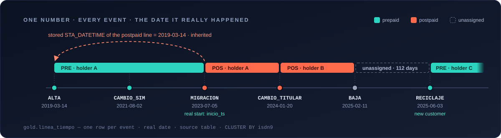
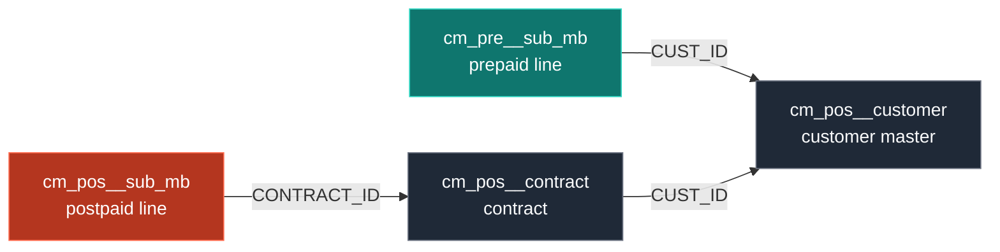
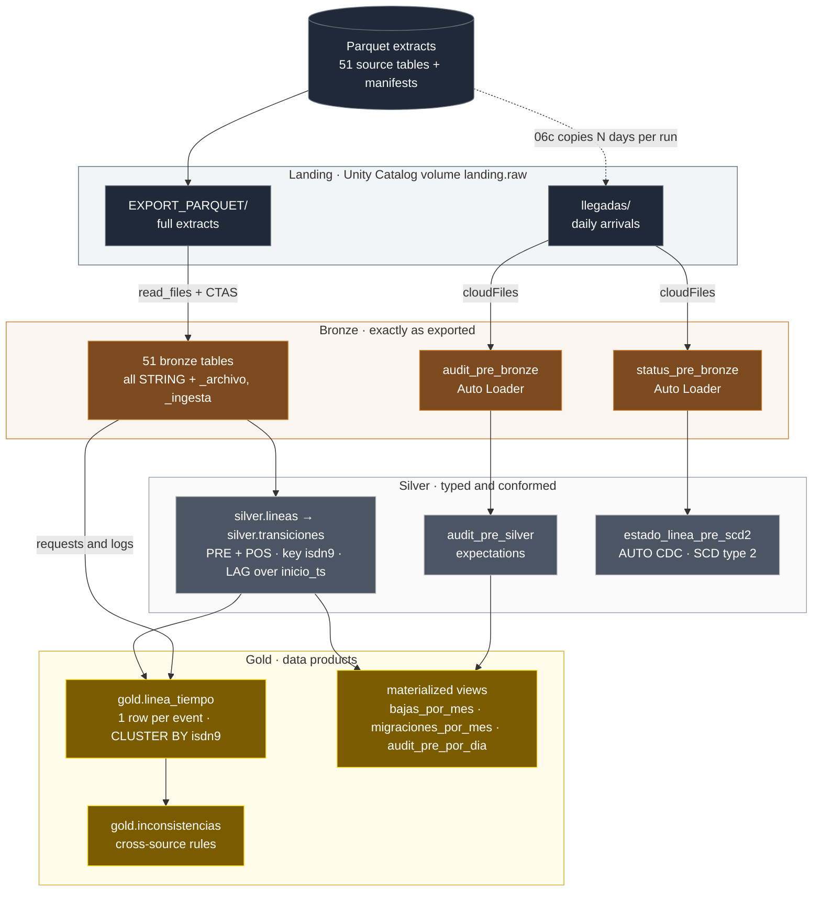
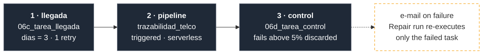

<div align="center">

# Subscriber Lifecycle Lakehouse

**The real history of every mobile number, rebuilt from a telecom CRM on Databricks.**<br>
Prepaid and postpaid lines, migrations, owner changes, porting and recycled numbers: one row per event, with the date it actually happened.

[](https://www.databricks.com/)
[](https://spark.apache.org/)
[](https://delta.io/)
[](https://docs.databricks.com/aws/en/data-governance/unity-catalog/)
[](https://docs.databricks.com/aws/en/ldp/)
[](https://spark.apache.org/docs/latest/api/python/)


<br>



<br>

[**The problem**](#why-this-is-harder-than-it-looks) · [**Architecture**](#architecture) · [**Data quality**](#data-quality) · [**Governance**](#governance-and-privacy) · [**Status**](#status) · [**Run it**](#run-it)

</div>

> [!NOTE]
> **Code only: there is no data in this repository.** `.gitignore` blocks Parquet, CSV, JSON and Excel files. The notebooks read extracts that you place in a Unity Catalog volume (see the [input contract](#input-contract)), and a pre-ingestion gate, [`00b_verificar_datos`](notebooks/00b_verificar_datos.py), scans every text column for values shaped like phone numbers, national IDs, e-mail addresses or full names before anything is loaded. Notebook text and identifiers are in Spanish.

## What it answers

*"What happened to this number, and when?"* A telecom CRM has no single place to look. A number's history is spread across prepaid and postpaid line tables, contracts, customers, request queues (migration, termination, owner change, SIM swap, number change, porting) and daily event logs: **51 source tables**. The goal is one table, `gold.linea_tiempo`, with **one row per event**, its real date and the table it came from.

<sub>Illustrative rows for one number (`isdn9 = 900000001`), synthetic values:</sub>

| `fecha_ts` | `sub_id` | `tipo_linea` | `tipo_evento` | `fuente` |
| :-- | --: | :-: | :-- | :-- |
| 2019-03-14 10:02 | 10001 | PRE | `ALTA` | `silver.lineas` |
| 2021-08-02 16:40 | 10001 | PRE | `CAMBIO_SIM` | `bronze.cm_pre__sub_sim_transfer` |
| 2023-07-05 11:10 | 10001 | PRE | `BAJA` | `silver.lineas` |
| 2023-07-05 11:10 | 20007 | POS | `MIGRACION` | `silver.transiciones` |
| 2023-07-05 11:10 | 20007 | POS | `ALTA` | `silver.lineas` |
| 2024-01-20 09:30 | 20007 | POS | `CAMBIO_TITULAR` | `bronze.cm_pos__change_owner_log` |
| 2025-02-11 08:00 | 20007 | POS | `BAJA` | `silver.lineas` |
| 2025-06-03 12:48 | 30002 | PRE | `RECICLAJE` | `silver.transiciones` |
| 2025-06-03 12:48 | 30002 | PRE | `ALTA` | `silver.lineas` |

The postpaid `ALTA` is dated 2023-07-05, when the migration happened, not 2019-03-14 as its stored `STA_DATETIME` says. The number then changes holder, is terminated, stays unassigned for 112 days and goes to a new customer under a new `sub_id`.

With that table in place, these become single queries:

- How many PRE → POS and POS → PRE migrations happen per month, and how many have no request behind them?
- What share of postpaid activations carry an inherited `STA_DATETIME`?
- How long does porting take, from request to execution?
- How many numbers were recycled to a new customer, and how long were they unassigned?
- Of the lines that changed owner, how many were terminated within the next 90 days?

## Why this is harder than it looks

### 1. Migrated lines inherit their activation date

When a prepaid line moves to postpaid, the CRM opens a new line (`sub_id`) and copies the prepaid activation date into it. Both periods of the number now start at the same instant:

| `isdn9` | `tipo` | `sub_id` | `STA_DATETIME` as stored | `END_DATETIME` |
| :-- | :-: | --: | :-- | :-- |
| 900000001 | PRE | 10001 | 2019-03-14 10:02 | 2023-07-05 11:10 |
| 900000001 | POS | 20007 | **2019-03-14 10:02** | |

Order the periods by that column and `LAG()` sees a tie, so the migration comes out reversed or at random. The fix is to order by an **effective start**, `inicio_ts`, built from one of three candidate sources: the prepaid twin's `END_DATETIME`, `MIG_DATETIME` when it is filled and coherent, or the request date in `MIGRATION_REQUESTS` / `REQUEST_TRANSFER_POSTPAID`. The choice is settled with evidence, not assumed:

- **Size of the problem:** PRE/POS pairs on the same number whose stored activation dates are less than a minute apart.
- **Independent check:** the activation milestone in `ACTION_AUDIT` (`ACTION_CODE = '00'`) normally lands within 15 minutes of the real activation, so an inherited date should fail that test.

```sql
-- silver.transiciones: the previous period of the same number
LAG(tipo) OVER (PARTITION BY isdn9 ORDER BY inicio_ts, sub_id) AS tipo_ant
-- sub_id breaks ties, so the order is deterministic
```

### 2. Prepaid and postpaid reach the customer by different paths



Postpaid lines hang from a contract, and the contract from the customer. Prepaid lines point at the customer directly, and both resolve against the same customer master. `silver.lineas` flattens the two into one typed table where `cust_id` means the same thing on every row.

### 3. Same number, different person

A number that changes hands is not a migration. Each transition between consecutive periods is bucketed by direction × same customer × days between the previous end and the new start (0 / 1–3 / 4–30 / more than 30):

| Pattern | Reads as |
| :-- | :-- |
| PRE → POS or POS → PRE, same customer, 0–3 days | **Migration** |
| New customer after a long gap | **Recycled number** |
| New holder recorded in `CHANGE_OWNER_LOG` while the line is active | **Owner change** (same line, new holder) |

## Architecture



| Layer | Contract | Main tables | Built with |
| :-- | :-- | :-- | :-- |
| **Bronze** | Exactly what was exported: every column `STRING`, plus `_archivo` (source file) and `_ingesta` (load time). Row counts must match the export manifest. | `bronze.<owner>__<table>` (51), `audit_pre_bronze` | `read_files` + CTAS, Auto Loader, `COPY INTO` |
| **Silver** | Typed timestamps, one key per number (`isdn9`), prepaid and postpaid in one shape, `sub_id` unique per line type, no duplicate events. | `silver.lineas`, `silver.transiciones`, `audit_pre_silver`, `silver.estado_actual_pre`, `estado_linea_pre_scd2` | joins, window functions, watermark + `dropDuplicates`, `MERGE` in `foreachBatch`, `AUTO CDC` |
| **Gold** | One row per event with a non-null date and its source. Every contradiction between sources is listed under the rule it breaks. | `gold.linea_tiempo`, `gold.inconsistencias`, `gold.diccionario_columnas`, materialized views | `UNION ALL` of 10 event types, higher-order functions, liquid clustering |

<sub>Pipeline tables (`audit_pre_*` and the materialized views) are published to `gold`, the pipeline's default schema.</sub>

## Design decisions

| Decision | Why | Where |
| :-- | :-- | :-- |
| Bronze keeps every column as `STRING` | The source mixes formats and carries malformed values. Typing once, in silver, turns a bad value into a counted `NULL` instead of a failed load. | `00_config`, `02` |
| Tolerant date parsing with a plausibility window | `try_to_timestamp` plus a 2000–2030 window: junk dates become `NULL` instead of winning a sort. | `ts()` in `00_config` |
| One number key: `isdn9` | The last 9 digits, whether the value arrives with `+51`, spaces or dashes. Pseudonymized values pass through unchanged, so the same key works on clear and hashed data. | `isdn9()` in `00_config` |
| Order periods by `inicio_ts`, not `STA_DATETIME` | The stored activation date is inherited on migration (see above). | `04` |
| Liquid clustering on the number, not partitions | Every traceability query filters by number. Partitioning on a high-cardinality key fragments the table, and clustering keys can change without a rewrite. | `02`, `08` |
| Destructive drills on a `SHALLOW CLONE` | A metadata-only copy: free to create, and `VACUUM` on the clone cannot delete the source's files. | `02` |
| Column masks instead of dynamic views | The policy lives on the table, so SQL, notebooks and BI tools all get the masked value without anyone having to remember the right view. | `07` |
| One expectation action per field | `DROP ROW` when the event date is missing (the row is unusable), log-only for checks worth watching, `FAIL UPDATE` for fields a regulatory report cannot do without. | `06b` |
| Last 30 days of logs, `availableNow` triggers | Fits the Free Edition compute quota: streams process what is pending and stop. | `00_config`, `05` |

## Data quality

| Check | Where | What it does |
| :-- | :-- | :-- |
| Inventory against the export manifest | `00b`, `02` | Compares each table's files and row count with what the export reported. |
| PII gate | `00b` | Runs 4 detectors (mobile number, national ID, e-mail, full name) over a 20,000-row sample of every text column. Any column where 30 % or more of the values match is listed and must be fixed, or documented as a false positive, before going on. |
| Date profile | `04` | Per line type: unparseable dates, end before start, cancelled without an end date, active with an end date. |
| Pipeline expectations | `06b` | `fecha_valida` drops rows without an event date; `codigo_presente` and `en_rango` are tracked in the event log. |
| Job gate | `06d` | Fails the job when nothing arrived or when more than 5 % of the rows were discarded (a job parameter). |
| Cross-source consistency | `08` | Terminations with no request or port-out within ±3 days, port-outs with no termination afterwards, owner changes after termination, events dated before the activation. |

<details>
<summary><b>Expectations and their results</b> (<code>06b_pipeline_trazabilidad.sql</code>)</summary>

```sql
CREATE OR REFRESH STREAMING TABLE audit_pre_silver (
  CONSTRAINT fecha_valida    EXPECT (issue_ts IS NOT NULL)        ON VIOLATION DROP ROW,
  CONSTRAINT codigo_presente EXPECT (ACTION_CODE IS NOT NULL),
  CONSTRAINT en_rango        EXPECT (year(issue_ts) BETWEEN 2000 AND 2030)
)
COMMENT 'ACTION_AUDIT prepago con fecha tipada'
AS SELECT *, try_to_timestamp(ISSUE_DATETIME, 'yyyy-MM-dd HH:mm:ss') AS issue_ts
FROM STREAM(audit_pre_bronze);
```

Rows passed and dropped per run, from the pipeline event log:

```sql
SELECT timestamp, details:flow_progress:data_quality:expectations AS expectativas
FROM event_log(TABLE(gold.audit_pre_silver))
WHERE event_type = 'flow_progress' AND details:flow_progress:data_quality IS NOT NULL
ORDER BY timestamp DESC;
```

</details>

## Governance and privacy

Unity Catalog covers what a privacy officer would ask for: classify the data, restrict what each person sees, grant the minimum and keep the evidence.

| Control | How |
| :-- | :-- |
| Classify | Column tags `pii = 'telefono'` / `'cliente'` and table tags (`dominio`, `clasificacion = 'confidencial'`), listed from `information_schema.column_tags`. |
| Mask | A SQL function attached to `silver.lineas.isdn9`: the authorized user sees the number, everyone else `*****` plus the last 4 digits. |
| Filter rows | A row filter on `silver.lineas`: everyone else sees prepaid lines only. |
| Least privilege | Analysts get `USE CATALOG` + `USE SCHEMA` + `SELECT` on `gold`, and nothing on `bronze`. |
| Trace | Lineage in Catalog Explorer and in `system.access.table_lineage`. |

```sql
CREATE OR REPLACE FUNCTION gobierno.mascara_numero(x STRING)
RETURNS STRING
RETURN CASE WHEN current_user() = 'owner@example.com' THEN x
            ELSE concat('*****', right(x, 4)) END;

ALTER TABLE silver.lineas ALTER COLUMN isdn9 SET MASK gobierno.mascara_numero;
```

| Querying as | `isdn9` | Rows of `silver.lineas` |
| :-- | :-- | :-- |
| Authorized user | `900000001` | prepaid and postpaid |
| Anyone else | `*****0001` | prepaid only |

> [!IMPORTANT]
> Masks are evaluated at query time. A job that joins or groups on `isdn9` has to run as a principal that sees the clear value: under the mask, `*****0001` stands for every number ending in 0001, so joins would silently merge different numbers. Where account groups exist, replace `current_user()` with `is_account_group_member('<group>')`.

## Orchestration



`job_trazabilidad` is a three-task Lakeflow Job. The first task copies the next N daily `ACTION_AUDIT` files into `llegadas/`, so every run sees new files and Auto Loader's checkpoint does real work. The quality gate fails the run when nothing arrived or the discard rate passes the threshold, and **Repair run** re-executes only what failed. The job is defined in the UI for now; declaring it as an Asset Bundle in `resources/databricks.yml` is on the [status](#status) list.

## How the build is organized

Eight chapters that follow the domains of the Databricks Certified Data Engineer Associate exam. Each one builds part of the lakehouse on the same data, and most close with review questions.

| Notebook | Builds | Platform features |
| :-- | :-- | :-- |
| `00_config`, `00b_verificar_datos` | Schemas, volumes and helpers; inventory and PII gate | Unity Catalog namespace, volumes |
| `01_plataforma` | Exploration of the landing files | `dbutils.fs`, `read_files`, widgets, compute types, Git folders |
| `02_delta_lake` | First bronze tables and a recovery drill | CTAS, `DESCRIBE HISTORY`, shallow clone, time travel, `RESTORE`, liquid clustering, `VACUUM` |
| `03_entidades_relacionales` | All bronze tables, views, column dictionary | managed and external tables, views, `INSERT OVERWRITE`, `MERGE`, `information_schema` |
| `04_transformaciones` | `silver.lineas`, `silver.transiciones` | joins, window functions, higher-order functions, `PIVOT`, UDF vs. native functions |
| `05_incremental` | Streaming bronze → silver, current status per line | Auto Loader, checkpoints, `COPY INTO`, watermarks, `foreachBatch` + `MERGE`, schema evolution |
| `06_lakeflow_pipelines_jobs`, `06b`–`06d` | Declarative pipeline and three-task job | streaming tables, materialized views, expectations, `AUTO CDC` (SCD type 2), Lakeflow Jobs, repair runs |
| `07_gobierno` | Tags, masks, row filters, grants | Unity Catalog privileges, column masks, row filters, lineage |
| `08_cierre_linea_de_tiempo` | `gold.linea_tiempo`, `gold.inconsistencias` | everything above |

## Status

Built in the open, chapter by chapter. Code that exists today:

- [x] Catalog, schemas, volumes and shared helpers (`00_config`)
- [x] Inventory check and PII gate (`00b`)
- [x] First bronze table via CTAS, with lineage columns and row counts reconciled against the manifest (`02`)
- [x] Shallow-clone sandbox, liquid clustering, `VACUUM` dry run (`02`)
- [x] `silver.lineas`, prepaid side (`04`)
- [x] Daily-arrival simulator (`05`, `06c`)
- [x] Lakeflow pipeline: Auto Loader → expectations → materialized views (`06b`)
- [x] Job quality gate (`06d`)
- [x] Masking function (`07`)
- [x] Timeline event model: 10 event types mapped to their source tables (`08`)

Next:

- [ ] Bronze loader for all 51 tables (`03`)
- [ ] Time-travel comparison and `RESTORE` (`02`)
- [ ] `silver.lineas`, postpaid side through contracts (`04`)
- [ ] `inicio_ts` and `silver.transiciones` (`04`)
- [ ] Streaming bronze → silver with watermark dedup, and `MERGE` for the current status (`05`)
- [ ] Status history with `AUTO CDC` (SCD type 2), drafted in `06b`
- [ ] Mask and row filter applied, grants (`07`)
- [ ] `gold.linea_tiempo` and `gold.inconsistencias` (`08`)
- [ ] PII gate that fails the run instead of listing findings (`00b`)
- [ ] Decision log, data policy and data dictionary (`docs/`)
- [ ] Asset Bundle for the job and the pipeline (`resources/databricks.yml`)
- [ ] Synthetic dataset, so anyone can run the project end to end

## Run it

**Requirements**

- A Databricks workspace with Unity Catalog. The defaults target **Databricks Free Edition** (serverless, catalog `workspace`); for another catalog, change `CATALOGO` in `00_config`.
- Parquet extracts that follow the [input contract](#input-contract). None are included.

**Steps**

1. **Workspace → Create → Git folder**, and paste `https://github.com/brando-rojas/telco-activations-lakehouse`.
2. Run `notebooks/00_config`. It creates the schemas `landing`, `bronze`, `silver`, `gold`, `sandbox` and `gobierno`, and the volumes `landing.raw` and `landing.checkpoints`.
3. Upload the extracts to `/Volumes/workspace/landing/raw/EXPORT_PARQUET/`.
4. Run `00b_verificar_datos`. Core tables must show `OK`, and the PII gate must come back empty or with every finding explained.
5. Work through `01` to `08` in order. Each chapter notebook starts with `%run ./00_config`.
6. Create the pipeline: **Jobs & Pipelines → Create → ETL pipeline**, source `notebooks/06b_pipeline_trazabilidad.sql`, catalog `workspace`, default schema `gold`, serverless, triggered mode.
7. Create `job_trazabilidad` with the three tasks shown under [Orchestration](#orchestration).

### Input contract

```text
/Volumes/workspace/landing/raw/EXPORT_PARQUET/
├── CM_PRE.SUB_MB/                        # one folder per source table, named OWNER.TABLE
│   ├── *.parquet                         # every column as text, dates as yyyy-MM-dd HH:mm:ss
│   └── manifiesto.json                   # {"exportadas": <row count>, ...}
├── CM_PRE.ACTION_AUDIT/                  # event logs: one file per day
│   ├── ACTION_AUDIT_20261001.parquet     # names end in _YYYYMMDD, so name order = date order
│   └── ...
└── ...                                   # full list in 00_config: CATALOGOS, LINEAS, TRAMITES, LOGS
```

The 51 tables are 16 reference catalogs (action codes, reasons, domain values, products, shops, staff, porting states), 6 line, product, contract and customer tables, 20 request tables (migration, transfer, plan change, termination, owner change, porting, SIM swap, number change) and 9 daily event logs.

**Free Edition limits the defaults respect**

- Daily compute quota: `DIAS_LOGS = 30` loads only the most recent days of each log, and the job should run at most once a day.
- One active pipeline per type and no custom storage locations, so every table is managed.
- Lineage system tables may be unavailable; Catalog Explorer still shows lineage.

## Repository layout

```text
telco-activations-lakehouse/
├── notebooks/
│   ├── 00_config.py                    # parameters, schemas, volumes, helpers (tb, ts, isdn9)
│   ├── 00b_verificar_datos.py          # inventory and PII gate
│   ├── 01_plataforma.py                # landing exploration, compute, Git folders
│   ├── 02_delta_lake.py                # bronze CTAS, history, clone, time travel, clustering
│   ├── 03_entidades_relacionales.py    # bronze loader, views, MERGE, column dictionary
│   ├── 04_transformaciones.py          # silver.lineas, inicio_ts, silver.transiciones
│   ├── 05_incremental.py               # Auto Loader, checkpoints, COPY INTO, streaming MERGE
│   ├── 06_lakeflow_pipelines_jobs.py   # pipeline and job walkthrough
│   ├── 06b_pipeline_trazabilidad.sql   # pipeline source: streaming tables, expectations, MVs
│   ├── 06c_tarea_llegada.py            # job task: daily arrivals
│   ├── 06d_tarea_control.py            # job task: quality gate
│   ├── 07_gobierno.py                  # tags, masks, row filters, grants, lineage
│   └── 08_cierre_linea_de_tiempo.py    # gold.linea_tiempo and consistency rules
├── docs/
│   ├── assets/linea-tiempo.svg         # README illustration
│   ├── decisiones.md                   # decision log
│   ├── politica_datos.md               # data handling and privacy policy
│   └── diccionario_trazabilidad.md     # data dictionary for lines and requests
├── resources/
│   └── databricks.yml                  # Asset Bundle (pending)
└── .gitignore                          # keeps data files out of the repo
```

---

<div align="center">

Built by **Brando Rojas** · data engineering × data protection · [GitHub](https://github.com/brando-rojas)

</div>
